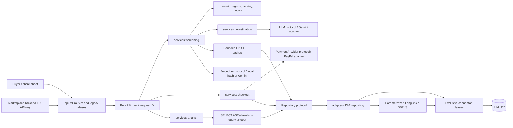
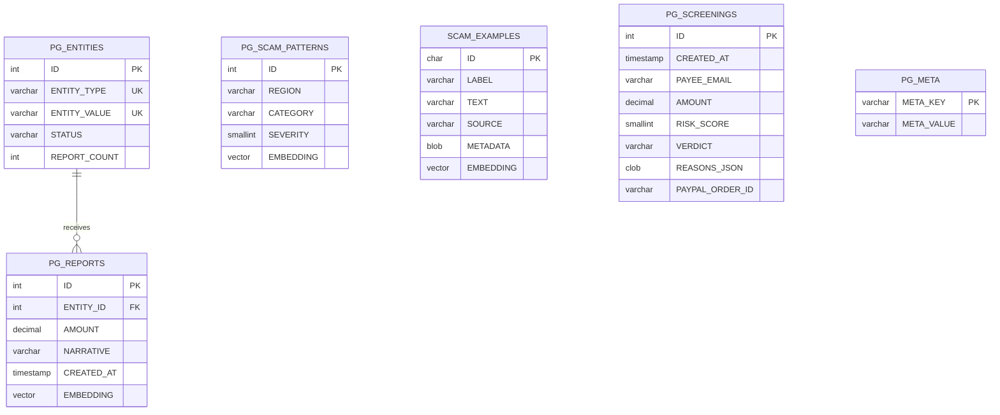
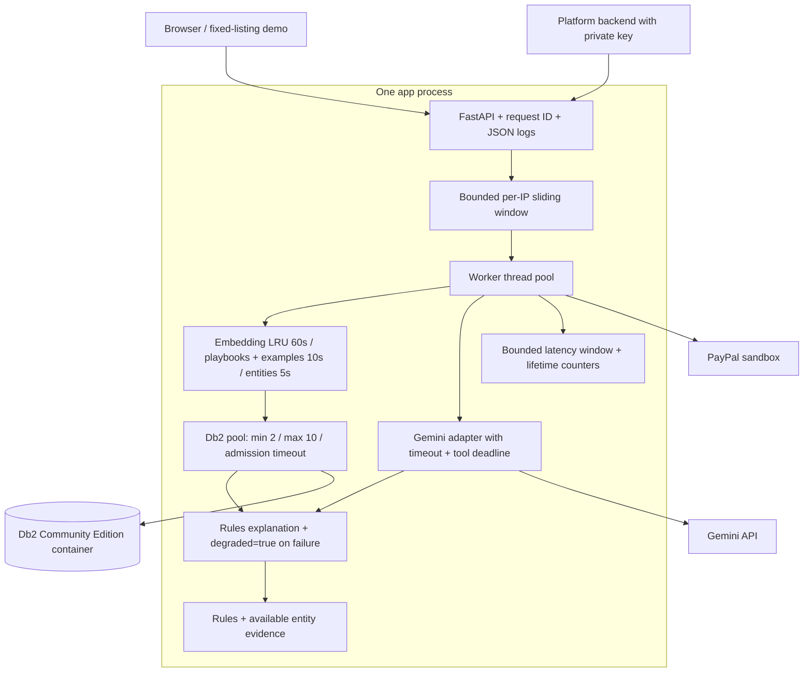

# PayGuard architecture

PayGuard screens a payment before money moves. Deterministic rules, entity intelligence,
vector retrieval and recent activity decide the baseline verdict. Optional Gemini
investigation can add risk. Checkout re-reads the persisted verdict and amount.

## Components and boundaries



| Layer | Responsibility |
|---|---|
| `src/api/` | Pydantic request models, authentication, admission, HTTP errors and routers |
| `src/services/` | Screening orchestration, investigation, analyst, presentation, checkout and health |
| `src/domain/` | Request/result value objects, 13 rule families, extraction and score fusion; protocol definitions |
| `src/adapters/` | Db2, IBM LangChain DB2VS, Gemini REST, PayPal REST, embeddings; seeded in-memory test adapter |
| `src/config.py` | Validated, immutable Pydantic settings; environment overrides private `.env` |
| `src/pool.py`, `src/cache.py`, `src/observability.py` | Shared infrastructure |

Old Python module names (`risk`, `db`, `llm`, etc.) remain compatibility imports. Coverage
is reported on the implementations rather than inflated by those small wrappers.
Repository, Embedder, LLM and PaymentProvider are structural Protocols. Production
composition uses Db2; tests inject the in-memory adapter and scripted providers.

## Screening sequence

```mermaid
sequenceDiagram
    participant Client
    participant API as API + limiter
    participant Service as Screening service (worker thread)
    participant Domain as Signals / scoring
    participant Cache as LRU + TTL
    participant Pool
    participant DB as Db2
    participant AI as Gemini (optional)
    Client->>API: POST /api/v1/screen
    API->>API: Validate input, assign X-Request-ID, admit IP
    API->>Service: Dispatch synchronous handler to thread pool
    Service->>Domain: Extract contacts, amounts and rule signals
    Service->>Cache: Entity lookup + query embedding + playbooks
    Cache->>Pool: Lease connection on a miss
    Pool->>DB: Ping; parameterized query; commit/rollback
    DB-->>Cache: Entity evidence / cosine matches
    Pool->>Pool: Rollback session; return healthy connection
    Service->>Pool: Fresh reports and velocity (uncached)
    alt Vector retrieval unavailable or timed out
        Service->>Domain: Rules + available entity evidence; degraded=true
    else Retrieval succeeds
        Service->>Domain: Fuse rules, entities, vectors and velocity
    end
    Service->>DB: Persist baseline screening via pool
    opt Explanation requested
        Service->>AI: Bounded tool investigation
        alt Gemini succeeds
            AI-->>Service: Explanation + extra risk clamped to 0..20
        else Gemini fails / deadline expires
            Service->>Service: Rules explanation; degraded=true if configured
        end
    end
    Service->>DB: Persist final verdict
    Service-->>Client: Verdict, evidence, degraded flag, X-Request-ID
```

FastAPI runs synchronous handlers and dependencies in worker threads. Async upload/share
handlers explicitly use `run_in_threadpool` after bounded file reads. Db2 waits and
Gemini REST calls do not run directly on the event loop. Tests hold a vision call open
while a second request completes. Driver statement/login timeouts and pool admission
deadlines bound Db2 calls; Gemini has HTTP timeouts plus a shared investigation deadline
checked between tool steps. A running worker/native call cannot be forcibly cancelled;
timeouts bound each operation rather than promising an absolute end-to-end deadline.

If persistence fails, the response has no screening ID and cannot authorize PayPal.
An unavailable screenshot reader returns 503 with a paste-text alternative: without
a readable transcript there is no evidence to screen. Rules-only operation without
configured AI is an intentional supported mode and does not itself mean degraded.

## Db2 data model



`PG_UQ_ENTITY(ENTITY_TYPE, ENTITY_VALUE)` prevents duplicate contacts. Report submission
leases one connection and commits MERGE escalation, report insertion and the response
lookup together. A failure rolls back the count and report. Only known, rolled-back
unique/deadlock conflicts are retried. Dropped connections never trigger blind write
replays: their commit outcome may be ambiguous.

`PG_V_ENTITY_RISK` aggregates reported loss; `PG_V_DAILY_VERDICTS` powers analytics.
`SCAM_EXAMPLES` contains only the cleaned training CSV. Retired IDs remove the historical
evaluation overlaps from existing installations. `heldout_v1.csv` is evaluation-only.

## Pool, cache, deployment and degraded mode



Each connection has one borrower. The condition lock protects bookkeeping, not queries.
The pool warms its configured minimum on startup, probes connections before reuse,
rolls back sessions on release, discards broken connections and replaces them on the
next checkout. A factory failure returns reserved capacity. Shutdown closes idle
connections and closes borrowed ones when returned. Total database connections equal
the sum of pool maxima across app processes.

Caches are bounded, thread-safe and return copies. Entity writes invalidate the entity
cache after commit, including negative lookups. A generation token prevents a lookup
already in flight from repopulating invalidated data. Reports, velocity, verdicts and
payment authorization are never cached. Entity status may be up to its short TTL stale
after writes by another process; multiple instances require shared invalidation.

The default per-IP quota is shared across protected routes and legacy/versioned aliases.
It uses the socket peer; only configure proxy forwarding for trusted proxy addresses.
The platform API requires `X-API-Key` and fails closed if no key is configured. The public
market demo accepts only two server-owned listing IDs, never arbitrary platform claims
or client amounts, and can be disabled with `PLATFORM_DEMO_ENABLED=false`.

`/api/health` probes Db2, reports pool state and embedder identity, and checks the
configured Gemini model (probe cached briefly). `/api/metrics` exposes lifetime request,
status and verdict counts, rolling p50/p95 latency, and cache hits/misses. Metrics and
rate limits are process-local; aggregate them externally for a multi-instance service.
Keep operational endpoints on the deployment's operations network when appropriate.

## Migrations and indexes

Run `python src/seed.py` to apply sorted `db/migrations/*.sql` files and seed missing data.
`PG_META` stores a checksum per successfully applied migration. A database lock serializes
migration application; changing an applied file is rejected. Add a new version instead.
The initial migration adopts existing tables without resetting user data. Use `--reset`
only for an intentionally disposable database.

| Query | Index / measured plan |
|---|---|
| Entity type + value | `PG_UQ_ENTITY`; real EXPLAIN shows `IXSCAN` |
| Entity report loss/history | `PG_IX_REPORT_ENTITY(ENTITY_ID, CREATED_AT)`; `IXSCAN` in entity view plan |
| Payee velocity | `PG_IX_SCREEN_PAYEE(PAYEE_EMAIL, CREATED_AT)`; real EXPLAIN shows `IXSCAN` |
| Region-filtered playbooks | `PG_IX_PATTERN_REGION(REGION, CATEGORY)`; `IXSCAN` followed by exact distance sort |
| Recent screenings | `PG_IX_SCREEN_RECENT(CREATED_AT DESC)` |
| Verdict/date analytics | `PG_IX_SCREEN_VERDICT(VERDICT, CREATED_AT)` |

Reproduce: `python scripts/explain.py --output .artifacts/explain.json`. The script captures
the production repository statements, refreshes RUNSTATS and records actual operators.
See [recorded plans](results/explain.json); costs are optimizer estimates, not latency.

IBM documents native vector indexes from **12.1.5**, whereas 12.1.2 introduced vector
storage and exact search. Migration 003 attempts cosine indexes on all three EMBEDDING
columns on suitable releases. The local 12.1.5 Community Edition installation rejected
creation with SQL0614/54008, even after enabling `DB2_VECTOR_INDEXING` and testing a 32 KB
tablespace. That optional migration remains **unapplied**, with the capability recorded
as deferred in `PG_META`; unrelated failures are raised. The measured workload uses
exact cosine search and retains the region pre-filter. No ANN speedup is claimed.
On a capable installation the migration applies normally. Validate ANN recall separately
before relying on approximate results for fraud evidence.

Sources: [IBM vector indexes](https://www.ibm.com/docs/en/db2/12.1.x?topic=indexes-vector),
[IBM fetch clause](https://www.ibm.com/docs/en/db2/12.1.x?topic=subselect-fetch-clause).

## Scaling path

At **10x traffic**, measure database waits, cache misses, error rates and queueing before
raising limits. Run horizontal app instances behind a load balancer, with a total pool
budget the database can sustain. Move rate limiting and caches to Redis using atomic
admission and report-driven invalidation. Put optional AI investigation on a bounded
queue; keep an initial rules verdict and a persisted, monotonic final verdict. Use read
replicas for dashboards and retrieval where replication lag is acceptable. Checkout and
fresh report/entity authorization must read the authoritative primary.

At **100x traffic**, isolate analytical reads, partition/archive screening history,
scale read replicas and retrieval independently, and make investigation workers consume
a durable queue with idempotent jobs. Adopt validated vector indexing on supported Db2
installations after measuring recall and post-filter behavior. Add distributed tracing,
shared metrics and capacity controls. Redis and replicas are future changes, not features
claimed to be implemented by this single-process prototype.

## Trade-offs

- A single Db2 source keeps entity/report transactions and payment audit state consistent,
  but makes Db2 availability a central dependency. Missing persistence disables checkout.
- Short TTLs reduce repeated work but allow brief staleness outside the current process.
  Shared invalidation is required before horizontally scaling entity intelligence.
- Thread offloading preserves responsiveness without an async Db2 driver. Worker and pool
  capacity still bound throughput; a timeout does not cancel arbitrary Python code.
- Exact vector search preserves deterministic scoring and works on the tested container.
  Its cost grows with rows, so ANN needs separate quality/performance validation.
- Local hash embeddings work offline and avoid model downloads; they miss paraphrases.
  The recorded evaluation has limited recall and is too small for production claims.
- The SQL guard rejects comments, unknown tables/functions and unvalidated syntax.
  This narrows the analyst's SQL flexibility in exchange for a fail-closed boundary.
- JSON request logs deliberately omit messages, credentials and payment details. Aggregate
  in-memory metrics provide lightweight visibility without persistent telemetry storage.

Decision records: [Db2](adr/001-db2-source-of-truth.md), [monotonic AI](adr/002-ai-only-raises-risk.md),
[pooling](adr/003-connection-pooling.md), [caching](adr/004-caching.md).
